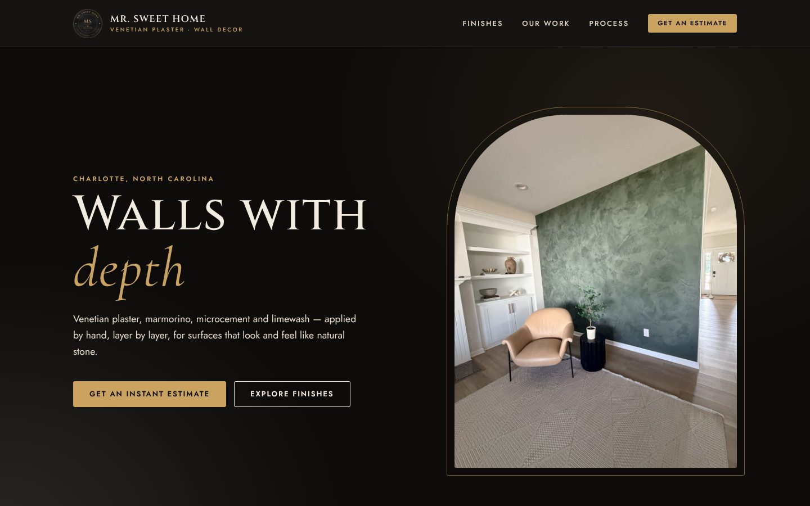
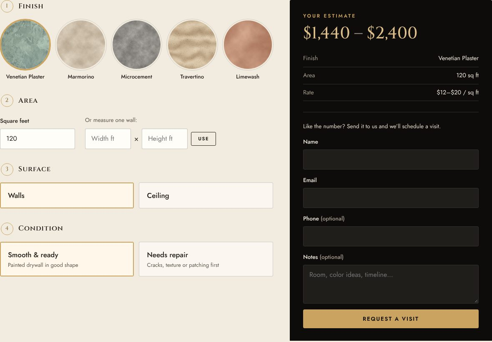
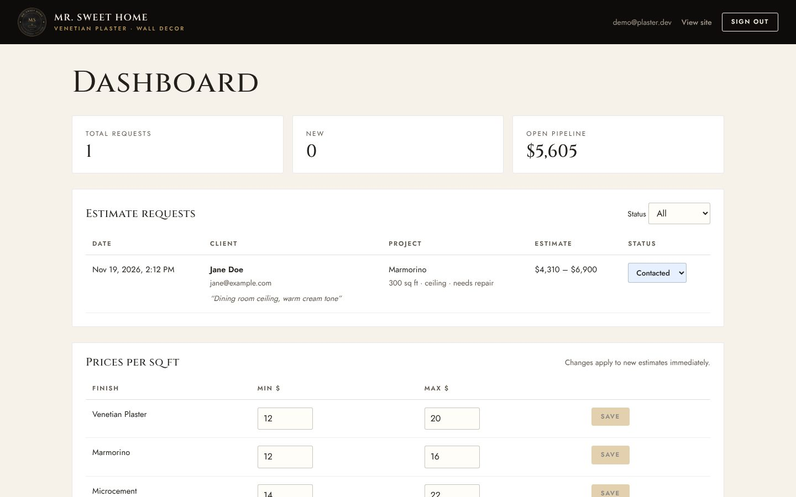

# Mr. Sweet Home — Venetian Plaster & Wall Decor

A full-stack website for a decorative plaster studio in Charlotte, NC: a finishes catalog,
an **instant cost calculator**, and a **password-protected admin dashboard** for managing
estimate requests and prices.

**🔗 Live demo:** _coming soon_



## Features

**For visitors**
- Multi-page React app with client-side routing: home, finishes catalog, a page for each finish, calculator, 404.
- **Instant estimate calculator** — pick a finish, enter square footage (or width × height), surface and wall condition, and see a live price range.
- Request a site visit straight from the calculator; the estimate is saved with the request.

**For the business owner**
- **Admin dashboard** behind a login: request list with status workflow (new → contacted → scheduled → closed), filtering, and summary stats (total, new, open pipeline value).
- **Edit prices per finish** — changes apply to new estimates immediately.

**Engineering details**
- **Pricing lives on the server.** The client always asks the API for a quote, and a submitted request is re-priced server-side, so a tampered price from the browser is ignored.
- **SQLite database** with a real schema: foreign keys, `CHECK` constraints, prepared statements, seeded catalog.
- **Authentication:** bcrypt-hashed passwords, JWT in an `httpOnly`, `SameSite=Strict` cookie, protected admin routes, and a dummy hash check so responses don't reveal which emails exist.
- Validation on both client and server, honeypot spam protection.
- **12 automated API tests** (pricing math, validation, auth, admin flows).
- Responsive and accessible: semantic HTML, keyboard-friendly custom radio controls, `aria-live` estimate, reduced-motion support.

| Calculator | Admin dashboard |
| --- | --- |
|  |  |

## Tech stack

| Layer    | Tools |
| -------- | ----- |
| Frontend | React 18, React Router 6, Vite, custom CSS |
| Backend  | Node.js, Express |
| Database | SQLite (better-sqlite3) |
| Auth     | bcryptjs, jsonwebtoken, httpOnly cookies |
| Testing  | `node:test`, Supertest |

## Project structure

```
├── client/                 # React app
│   └── src/
│       ├── pages/          # Home, Finishes, FinishDetail, Estimate, AdminLogin, AdminDashboard, NotFound
│       ├── components/     # Layout (header/footer), FinishCard
│       ├── api.js          # fetch wrapper for the REST API
│       └── styles.css
└── server/
    ├── src/
    │   ├── app.js          # routes: public, auth, admin
    │   ├── db.js           # schema, seeding, queries helpers
    │   ├── estimate.js     # pricing + validation
    │   ├── auth.js         # login, JWT cookie, requireAdmin middleware
    │   └── seed.js         # default finishes and pricing settings
    └── test/
```

## API

| Method | Endpoint | Auth | Description |
| ------ | -------- | ---- | ----------- |
| GET    | `/api/finishes` | – | List finishes with prices |
| GET    | `/api/finishes/:slug` | – | One finish |
| POST   | `/api/estimate` | – | Price a job: `{ finish, area, surface, condition }` |
| POST   | `/api/requests` | – | Save a visit request (re-priced on the server) |
| POST   | `/api/auth/login` | – | Sign in, sets `httpOnly` cookie |
| POST   | `/api/auth/logout` | ✔ | Sign out |
| GET    | `/api/admin/requests?status=` | ✔ | List requests |
| PATCH  | `/api/admin/requests/:id` | ✔ | Update status |
| GET    | `/api/admin/stats` | ✔ | Dashboard numbers |
| PATCH  | `/api/admin/finishes/:id` | ✔ | Update price range |

## Getting started

Requires Node.js 20+.

```bash
npm install
npm run dev      # API on :3002, React dev server on :5173 (proxies /api)
npm test         # run API tests
```

Production:

```bash
npm run build && npm start   # Express serves the API and the built React app
```

Environment variables (all optional for local use):

| Variable | Purpose |
| -------- | ------- |
| `ADMIN_EMAIL`, `ADMIN_PASSWORD` | Admin login. If unset, a demo login is used: `demo@plaster.dev` / `demo1234` |
| `JWT_SECRET` | Secret for signing sessions (random per start if unset) |
| `DB_FILE` | Path to the SQLite file |

## Notes

- Catalog prices are placeholders and can be changed from the admin dashboard.
- Finish images: the Venetian plaster swatch and the "Our work" photos are real projects; the other swatches are generated textures.
- On the free demo hosting the database resets when the server restarts.

## What I'd add next

- Email notification to the owner for each new request
- Image upload for finishes from the admin dashboard
- PostgreSQL for persistent production data

---

Built by [Roman Stepanovskyi](https://www.linkedin.com/in/roman-stepanovskyi).
